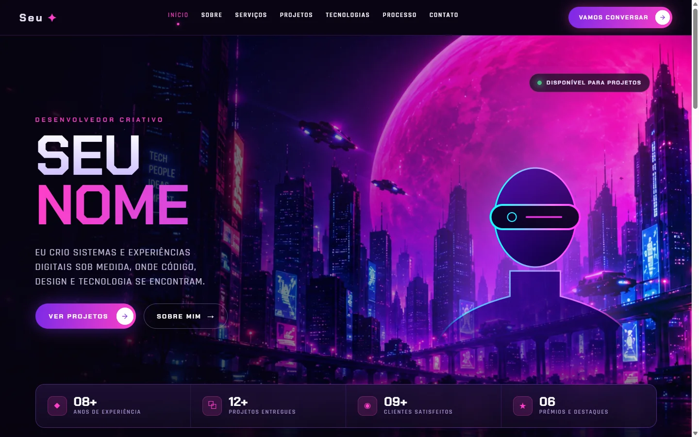

# Portfólio Cyberpunk

Template de portfólio com visual cyberpunk (neon, roxo e rosa), feito com **Vite + React + TypeScript + Tailwind**. É um site estático: sem backend, sem banco de dados e sem variáveis de ambiente.



> O conteúdo (nome, contatos, projetos, depoimento) é de exemplo. Veja [Como personalizar](#como-personalizar).

## O que tem no site

**Página inicial** (`/`), uma página longa com estas seções, nesta ordem:

| Seção | O que mostra |
|---|---|
| Hero | Nome, frase de apresentação, retrato, status de disponibilidade e métricas |
| Sobre | Texto de apresentação e uma ilustração |
| Serviços | Cartões com o que você oferece |
| Projetos | Cartões que abrem um modal com galeria (desktop, mobile e tablet) |
| Tecnologias | Ícones da sua stack |
| Processo | Etapas do seu fluxo de trabalho |
| Depoimentos | Feedback de clientes |
| Contato | Chamada para ação com link do WhatsApp |

**Materiais** (`/materiais`), uma biblioteca de links organizada por categorias, com busca e paginação. Serve para listar ferramentas, skills ou recursos que você recomenda. Cada categoria tem URL própria, como `/materiais/skills`.

**Páginas legais** (`/politica-de-privacidade` e `/termos-de-uso`), páginas HTML estáticas em `public/`.

## Como rodar

Precisa do [Node.js](https://nodejs.org) instalado.

```bash
npm install
npm run dev       # servidor de desenvolvimento
npm run build     # gera o site final em dist/
npm run preview   # serve o dist/ localmente para conferir
npm run lint      # verifica o código com oxlint
```

## Como funciona, por alto

- **Quase tudo é dado, não código.** Textos, links, projetos, serviços e depoimentos ficam em `src/data/content.ts`. Os itens e categorias de `/materiais` ficam em `src/data/materiais.ts` e `src/data/materiais-categorias.ts`. Os componentes só leem esses arquivos e desenham a tela, então a maior parte das edições não exige mexer em JSX.
- **Sem biblioteca de rotas.** `src/Raiz.tsx` olha o endereço da página: se começa com `/materiais`, carrega a área de materiais; qualquer outro caminho mostra a página inicial. Dentro da página inicial, o menu navega por âncoras (`#sobre`, `#projetos`...) e destaca a seção visível conforme você rola.
- **SEO por página gerado no build.** Rastreadores e prévias de link não executam JavaScript. Por isso, o `vite.config.ts` tem um plugin que, depois do build, cria um `index.html` para cada categoria de materiais, com título, descrição e `canonical` próprios.
- **Visual com Tailwind v4.** A configuração fica no CSS (`src/index.css`), não em um `tailwind.config.js`. As animações usam `framer-motion`.
- **Modal de projetos.** Cada projeto tem uma galeria por dispositivo. Sem imagem em `src`, o modal mostra um placeholder.

## Estrutura

```text
src/
  Raiz.tsx            decide qual "página" mostrar
  App.tsx             página inicial: lista de seções
  components/         Hero, Sobre, Servicos, Projetos, Materiais, Footer...
  data/               todo o conteúdo editável
  assets/images/      imagens importadas pelos componentes
public/               arquivos servidos como estão (páginas legais, sitemap, robots, llms.txt)
docs/preview.webp     captura usada neste README
vite.config.ts        plugin de SEO por rota
```

## Como personalizar

1. **Identidade e contatos:** em `src/data/content.ts`, troque nome, e-mail, WhatsApp, serviços, projetos e depoimentos. As redes sociais ficam em `src/components/Footer.tsx`.
2. **Domínio e SEO:** troque `seudominio.com` em `src/data/materiais-categorias.ts` (`SITE_URL` e `SITE_NOME`), `index.html`, `public/sitemap.xml`, `public/robots.txt` e `public/llms.txt`. Em `index.html`, atualize também o título e a descrição.
3. **Foto:** `src/assets/images/hero-retrato.svg` é um placeholder. Troque pela sua foto (PNG ou WebP com fundo transparente, cerca de 416x599) e ajuste o `import` em `src/components/Hero.tsx`. Se a imagem não for transparente, o efeito de máscara do hero não vai ficar bom.
4. **Capturas dos projetos:** coloque as imagens em `public/projetos/<projeto>/` e preencha `src` em `galeria`, por exemplo `'/projetos/meu-projeto/home.webp'`. Atenção: `public/projetos/` está no `.gitignore` porque capturas costumam ter dados de clientes. Se quiser versionar as imagens, remova essa linha de `.gitignore`.
5. **Materiais:** copie um item de `src/data/materiais.ts` e troque os campos. Para uma categoria nova, adicione em `src/data/materiais-categorias.ts`; a rota `/materiais/<slug>` passa a existir sozinha.
6. **Páginas legais:** edite `public/politica-de-privacidade/index.html` e `public/termos-de-uso/index.html` (nome, e-mail, domínio). O texto é um modelo; revise com um profissional antes de usar.
7. **Analytics (opcional):** o bloco do Microsoft Clarity em `index.html` está comentado. Para ativar, coloque o ID do seu projeto e remova o comentário. Se não for usar, retire também a menção ao Clarity na política de privacidade.

### Adicionar uma seção nova

Crie o componente em `src/components/`, inclua-o na lista de `src/App.tsx` e adicione o link correspondente no menu de `src/components/Header.tsx`.

## Licença

O projeto é distribuído sob a licença [MIT](LICENSE): você pode usar, copiar, modificar e distribuir livremente, inclusive em projetos comerciais, mantendo o aviso de copyright. Isso vale também para as ilustrações incluídas (`hero-916.webp` e `hero-cidade-neon.webp`, geradas com IA).

## Publicação

Qualquer hospedagem de site estático serve (Cloudflare Pages, Netlify, Vercel, GitHub Pages...). Use `npm run build` como comando de build e `dist` como pasta de saída. Como o site usa caminhos como `/materiais` e `/termos-de-uso`, a hospedagem precisa servir `index.html` de cada pasta (o padrão na maioria delas).
